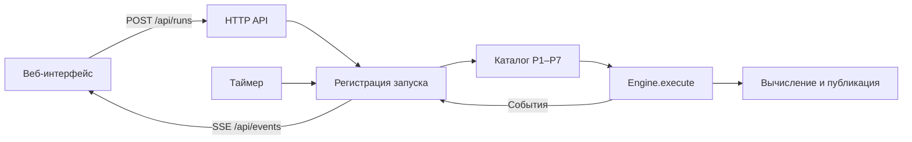

# Risk Orchestrator

Локальный прототип управления параллельными расчётами. Один процесс Python обслуживает веб-интерфейс, расписание и ядро.

## Запуск

Из корня проекта в окружении Python 3.12:

```console
python -m pip install -r requirements.txt
python api.py
```

Открыть http://127.0.0.1:8080. Данные и журнал хранятся в памяти. Исходные срезы A и B подготовлены за 19 и 20 ноября 2026 года. Каждые 60 секунд таймер обновляет A за 20-е. Сессии операторов синтетические и предназначены для локального демо.

Кнопка «Демо конфликта» запускает обновление с трёхсекундным удержанием среза и два чтения. На начальных данных читатель за 19-е возвращает 9, за 20-е получает 30 после обновления. Выберите номер запуска, чтобы увидеть его историю. Ручные расчёты и демо используют общее хранилище.

## Архитектура



GET /api/catalog возвращает спецификации процессов. POST /api/runs принимает JSON с полями process и day и возвращает 202 с номером запуска ядра. GET /api/runs возвращает последние запуски с результатами. SSE отправляет полный снимок при подключении и изменениях. POST /api/demo принимает JSON и запускает демонстрацию. Контракт вычислений описан в [ARCHITECTURE.md](ARCHITECTURE.md).

## Проверка

```console
python -B -W error -m unittest -v
```
