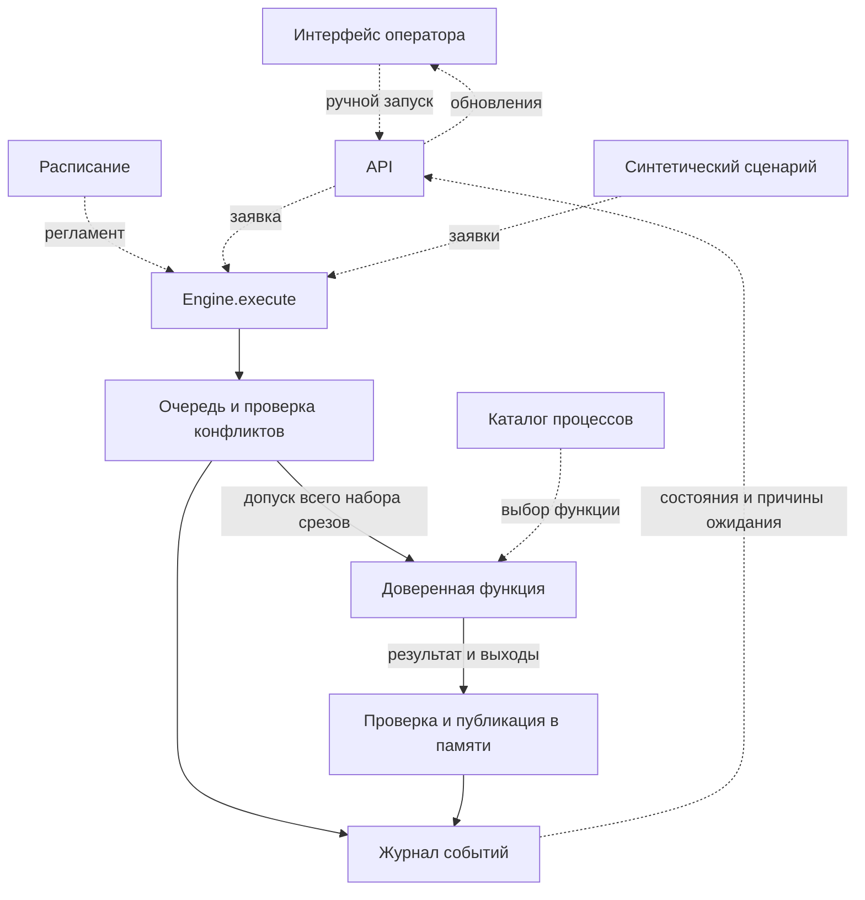

# Risk Orchestrator

Ядро допускает параллельные расчёты по объявленным входам и выходам. Сплошные стрелки показывают реализованные связи внутри одного процесса Python. Пунктиром обозначены будущие компоненты.

Контракт и ограничения описаны в [ARCHITECTURE.md](ARCHITECTURE.md). Реализация находится в core.py, проверки — в test_core.py. Из корня проекта на Python 3.12 выполните `python -B -m unittest -v test_core`.

Файлы API, расписания, каталога процессов, демосценария, веб-интерфейса и интеграционных тестов зарезервированы для следующего этапа. В docs предусмотрены материалы анализа инцидентов и презентации.
